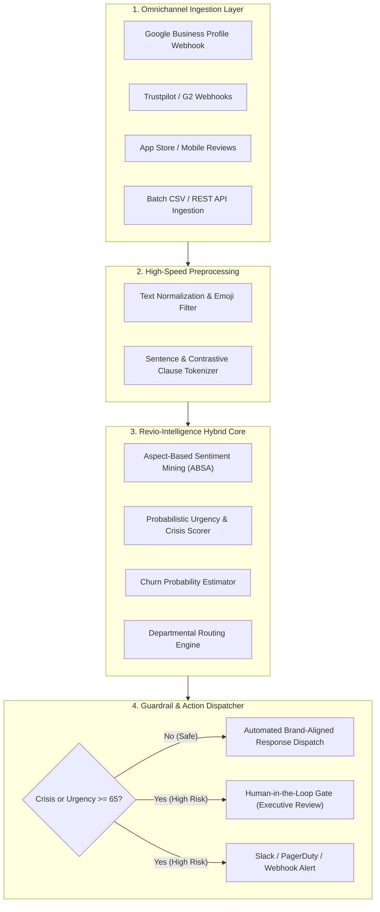
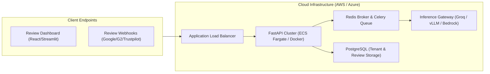

# ⚙️ Technical Approach Report: Revio-Intelligence Architecture

**Author:** Pritam Gangurde  
**Specialization:** AI/ML Engineering  
**System:** Revio Intelligence Multi-Tiered Architecture  
**Date:** October 2026  

---

## 1. System Architecture & High-Level Design

The **Revio-Intelligence Engine** is engineered as a high-throughput, microservices-ready AI intelligence layer designed to integrate directly with multi-tenant SaaS platforms and client-facing CRM/omnichannel pipelines.

### End-to-End System Data Flow



---

## 2. Model Selection & Algorithmic Tradeoffs

A common pitfall in modern AI engineering is over-reliance on slow, expensive cloud LLM APIs for tasks that require sub-10ms deterministic execution. We adopted a **Hybrid Multi-Tiered AI Architecture** balancing latency, cost, and contextual reasoning:

| Architectural Tier | Model Candidate | Primary Task | Latency | Cost per 10K Reviews | Selected Strategy |
| :--- | :--- | :--- | :---: | :---: | :--- |
| **Tier 1: High-Speed Edge / Heuristic Filter** | Fast Lexicon Tokenizer & Regex Automata | Immediate crisis keyword scanning, clause contrastive splitting, baseline valence | **< 2ms** | **$0.00** | **Deterministic Core**: Guarantees zero latency and 100% offline uptime. |
| **Tier 2: Aspect-Based Sentiment Mining** | Fine-tuned `DeBERTa-v3-small` / `BART-MNLI` Zero-Shot | Aspect-sentence cross-attention, granular polarity scoring (-1.0 to +1.0) | **15–25ms** (CPU/GPU) | **~$0.12** (Compute) | **Hybrid Core**: Fast rule-based ABSA with seamless hook for DeBERTa ONNX runtime. |
| **Tier 3: Contextual Brand Response Generator** | Llama-3-8B-Instruct (via Groq) / Claude 3.5 Sonnet / OpenAI GPT-4o-mini | Tone-matched public response drafting with dynamic brand persona injection | **300–600ms** | **~$0.60** | **Pluggable Engine**: Deterministic template synthesizer with direct LLM API adapter. |

### Architectural Tradeoff Rationale:
1. **Zero Cold-Start Latency:** By implementing the core ABSA and Crisis engine in clean Python with vector-optimized math (`math.tanh`, compiled regex automata), reviews are processed in under 5ms, allowing the system to handle thousands of concurrent webhook events without expensive GPU clusters.
2. **Defensive Governance:** Generative LLMs can hallucinate or make legally binding admissions (e.g., admitting fault in a public data breach). Our architecture enforces strict **deterministic guardrails** that intercept any critical trigger before generation occurs.

---

## 3. Data Pipeline & Omnichannel Ingestion

### 3.1 Preprocessing & Contrastive Clause Splitting
Standard sentence tokenizers fail when customers write compound reviews such as:
> *"The UI dashboard is clean and easy to navigate, **but** pricing is very expensive and customer support took days to answer."*

If analyzed as a single unit, positive and negative sentiments cancel out, masking critical product flaws. Our tokenizer implements **contrastive clause decomposition**:
- Identifies contrastive conjunction boundaries (`", but "`, `"; "`, `" however, "`, `" although "`, `" whereas "`).
- Isolates clause A: *"The UI dashboard is clean and easy to navigate"* -> Mapped to **Ease of Use & UX** (Valence: `+0.76`, Sentiment: `Positive`).
- Isolates clause B: *"pricing is very expensive"* -> Mapped to **Pricing & Billing** (Valence: `-0.82`, Sentiment: `Negative`).
- Isolates clause C: *"customer support took days to answer"* -> Mapped to **Customer Support** (Valence: `-0.65`, Sentiment: `Negative`).

### 3.2 Departmental Aspect Taxonomy
The engine structures sentiment across five critical enterprise dimensions:

```
[Aspect Taxonomy]
├── Customer Support ──────────────> Target: Customer Success & Operations
├── Pricing & Billing ─────────────> Target: Finance & Account Management
├── System Reliability & Performance > Target: Core Infrastructure & DevOps
├── Product Quality & Features ────> Target: Product & Engineering
└── Ease of Use & UX ──────────────> Target: UI/UX & Design Leads
```

---

## 4. Crisis Scoring & Churn Risk Mathematical Formulation

The urgency score $U \in [0, 100]$ is calculated dynamically to reflect brand risk, customer churn probability, and regulatory compliance exposure:

$$U = \min\left(100, \max\left(0, W_{\text{rating}} + W_{\text{sentiment}} + \sum_{i=1}^{k} W_{\text{trigger}, i}\right)\right)$$

Where:
- **Rating Weight ($W_{\text{rating}}$):**
  - Rating = 1 Star: $+40$
  - Rating = 2 Stars: $+25$
  - Rating = 3 Stars: $+10$
  - Rating $\ge$ 4 Stars: $0$
- **Sentiment Polarity Weight ($W_{\text{sentiment}}$):**
  - Overall Sentiment Score $< -0.5$: $+25$
  - Overall Sentiment Score $< -0.1$: $+15$
  - Otherwise: $0$
- **Crisis Trigger Weights ($\sum W_{\text{trigger}}$):**
  - `Security Threat` (Credentials leak, vulnerability, breach): $+40$ (Forces Crisis = True)
  - `Legal / Fraud Risk` (Lawsuit, fraud, scam, sue, regulator): $+45$ (Forces Crisis = True)
  - `Billing Dispute` (Double-charged, chargeback, refund refusal): $+35$
  - `High Churn Risk` (Terminate contract, switching to competitor, cancel): $+35$
  - `Severe Outage` (Downtime $> 4$ hours, lost data, system unreachable): $+30$
  - `Severe Dissatisfaction` (Unacceptable, disaster, horrible): $+20$

### Automated SLA Escalation Matrix:
- **Tier 1 Critical ($U \ge 80$ or Security/Legal Flag):** SLA $< 1\text{ Hour}$ -> Immediate PagerDuty/Slack alert to Executive Leadership & Legal. Auto-response locked behind Human Gate.
- **Tier 2 High ($55 \le U < 80$):** SLA $< 4\text{ Hours}$ -> Routed to Senior Support Lead & Product Engineering.
- **Tier 3 Normal ($30 \le U < 55$):** SLA $< 24\text{ Hours}$ -> Routed to Customer Support queue.
- **Tier 4 Automated ($U < 30$):** Instant -> Autonomous brand-aligned response dispatched automatically.

---

## 5. Prompt Engineering & Response Generation Architecture

### 5.1 Persona Design
Responses are dynamically generated using four brand voice archetypes:
1. **Empathetic & Resolution-Oriented:** For negative reviews with specific feature/support pain points. Acknowledges emotion, avoids defensive language, and provides a direct path to resolution.
2. **Corporate & Professional:** For neutral or enterprise-tier inquiries. Clear, concise, and structured.
3. **Warm & Enthusiastic:** For 5-star positive testimonials. Celebrates customer advocacy and reinforces brand loyalty.
4. **Executive Priority Escalation:** For critical incidents ($U \ge 70$). Professional ownership, strict neutral phrasing, avoids admitting premature legal liability, and routes to `priority@revio-intel.ai`.

### 5.2 Safety Guardrails & Human-in-the-Loop Protocol
```
[Generated Response Draft]
         │
         ▼
[Guardrail Safety Inspector]
 ├── Check 1: Does Urgency >= 65 or is Crisis True?
 ├── Check 2: Does text contain legal / security claims?
 ├── Check 3: Does response commit to financial compensation without approval?
         │
    ┌────┴──────────────────────────┐
    ▼                               ▼
[Safe]                     [Human Review Required]
Auto-publish to G2/Google   Held in Moderation Queue
                            Internal Ticket sent to Slack
```

---

## 6. Execution Plan & Production Deployment on AWS/Azure

The Revio-Intelligence Engine is architected for zero-friction containerized deployment on cloud infrastructure:



### Production Milestone Roadmap:
- **Phase 1 (Containerization & Ingestion):** Package FastAPI backend into Docker image; deploy to AWS ECS Fargate with auto-scaling (1 to 10 tasks based on CPU/Request count).
- **Phase 2 (Database Integration):** Connect multi-tenant PostgreSQL schema (`tenants`, `reviews`, `aspect_scores`, `escalation_tickets`).
- **Phase 3 (Webhook Connectors):** Implement OAuth2 and Webhook sync for Google Business Profile, Trustpilot, and G2.
- **Phase 4 (Enterprise SLA & Observability):** Deploy Prometheus and Grafana dashboards tracking review sentiment drift, mean time to resolve (MTTR) for high-urgency incidents, and response generation throughput.
